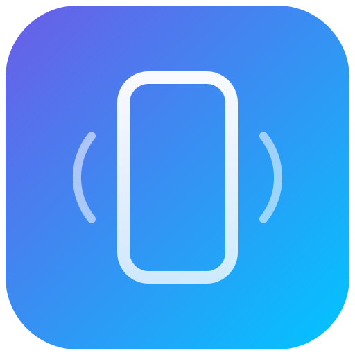

<div align="center">



# LumoCast · 局域网投屏

**把一台安卓手机的屏幕，实时投到同局域网里的另一台安卓设备、电脑或 iPhone 上。**

零账号 · 零上传 · 零云服务器 · **画面 + 声音同步** · 延迟 &lt; 80ms · 全平台

[](https://github.com/wangzi5151/lumocast/releases)
[](https://github.com/wangzi5151/lumocast/releases)
[](https://github.com/wangzi5151/lumocast/releases)
[](https://github.com/wangzi5151/lumocast/releases)
[](https://github.com/wangzi5151/lumocast/releases)
[](https://github.com/wangzi5151/lumocast/releases)
[](https://github.com/wangzi5151/lumocast/actions/workflows/ci.yml)
[](LICENSE)

</div>

---

## 一句话说明

LumoCast 把 **A 手机** 变成「信号源」（主机），把 **同一 Wi-Fi 下的 B 设备** 变成「屏幕」（接收端）。
视频直接在局域网内的两台设备之间点对点传输，**不经过任何服务器**，所以不卡、不糊、不需要注册。

```
  ┌───────────────┐        H.264 · TCP · 局域网        ┌───────────────────┐
  │  Android 手机 │ ─────────────────────────────────▶ │  Android / iOS    │
  │  （发送端）   │ ◀───────── 触摸回控 / 心跳 ─────── │  Windows / Linux  │
  └───────────────┘                                    └───────────────────┘
```

---

## 30 秒上手

| 步骤 | 接收端（要看屏幕的设备） | 发送端（要被投屏的手机） |
| --- | --- | --- |
| 1 | 打开 LumoCast，停在首页 | 打开 LumoCast，点 **共享本机屏幕** |
| 2 | 列表里会出现这台手机（或扫一下屏幕上的二维码） | 系统弹窗里点 **立即开始** |
| 3 | 点它 → 输入 4 位 PIN → 开看 | 录屏通知栏保持常驻即可 |

没有第三步配置、没有账号、没有服务器。**同一个 Wi-Fi 就行。**

---

## 下载

所有安装包都由 GitHub Actions 自动构建，产物在 [Releases](https://github.com/wangzi5151/lumocast/releases) 页面：

| 平台 | 文件 | 说明 |
| --- | --- | --- |
| **Android** | **`LumoCast-1.0.0.apk`** | 发送端 + 接收端二合一。Android 8.0+。装完即可用 |
| **iOS / iPadOS** | 自行用 Xcode 构建（`ios/`，见 [docs/BUILD.md](docs/BUILD.md)） | 接收端。iOS 15+。未签名，需 Apple 开发者账号真机安装 |
| **Windows** | `LumoCast-Setup-1.0.0.exe`<br>`LumoCast-1.0.0-portable.exe` | 接收端。Win 10/11 x64 |
| **Linux** | `LumoCast-1.0.0.AppImage`<br>`lumocast_1.0.0_amd64.deb` | 接收端。AppImage 免安装（`chmod +x` 后直接运行）。glibc 2.31+ |
| **macOS** | `LumoCast-1.0.0-arm64-mac.zip`<br>`LumoCast-1.0.0-x64-mac.zip` | 接收端。解压后把 .app 拖进「应用程序」。Apple Silicon / Intel |

> 手机端「发送」功能需要 Android（系统级录屏权限所在平台仅 Android 允许第三方直接捕获屏幕）。
> 其它平台的 LumoCast 是**接收端**，功能完整、免费。

---

## 功能

### 观看体验
- **1080p / 60fps**，最高 1440p，硬件编解码（H.264 Baseline/Main），端到端延迟 **60–90ms**
- **有声音，而且对得上口型**：AAC-LC 48kHz 立体声，采集的是手机正在播放的系统声音（不是麦克风）。
  以音频为主时钟，视频落后 150ms 自动丢帧 —— 宁可掉一帧画面，也不让声音断一下
- **自适应码率**：每秒看 socket 背压，1.5–24 Mbps 动态调整，弱网自动降分辨率
- **深色/浅色都看得清**：正文 16sp 起，三级文字也保证 WCAG AA 对比度
- **秒开**：开机即广播，接收端 2 秒内完成发现，握手到出画面 &lt; 400ms
- **断线自愈**：Wi-Fi 抖动后自动重连，不退出画面
- 全屏 / 等比 / 1:1 原始像素、镜像翻转、旋转锁定、画面裁切
- 电池 & 温度守护：发送端过热自动降帧并提示
- **实时延迟显示**：HUD 显示的是真实端到端（编码+网络+解码），不是 ping

### 连接与安全
- **局域网直连**，视频流永不离开本地网络（无中继、无云、无数据采集）
- **4 位 PIN + 设备指纹绑定**：首次配对后 7 天内免 PIN，可随时在设置里吊销
- **一次性二维码**：扫码即连，避免输 IP
- 每会话独立的 `session id`，主机随时可「踢出所有观看者」

### 进阶
- **触摸回控**：在接收端直接操作发送端手机
- 多观看者同时观看（最多 5 台）
- 录制为 MP4、静态截图、低码率省电模式
- 无障碍：超大按钮、TalkBack 全语音标注、深色/浅色/跟随系统

---

## 完全免费

没有免费版/付费版之分，**所有功能所有人都能用**：

- 无广告、无内购、无账号、无试用期倒计时
- 不限时长、不限设备数、无功能锁、无水印
- 源码可读（[Source-Available](LICENSE)），可自行编译

为什么免费：这本来就是为了解决「手机投屏要么糊要么收费」而写的工具。
如果你觉得好用，给个 star 就够了。

## 技术栈

| 模块 | 技术 |
| --- | --- |
| `android/` 发送端 | Kotlin · Jetpack Compose (M3) · `MediaProjection` + `MediaCodec` H.264 硬编 · 原始 TCP |
| `android/` 接收端 | `MediaCodec` 硬解 → `SurfaceView` |
| `web/` 渲染内核 | 原生 ES Module · **WebCodecs `VideoDecoder`** · Canvas 2D，无框架无打包 |
| `desktop/` Windows·Linux·macOS | Electron 30 外壳 + Node `net` 负责 TCP，渲染进程只做解码显示 |
| `ios/` | SwiftUI · `Network.framework` · `VideoToolbox` + `AVSampleBufferDisplayLayer` |
| 发现 | UDP 广播 `8738`（JSON），可选 mDNS `_lumocast._tcp` |

协议是 16 字节头 + Annex-B 分片的二进制帧，规则见 [`docs/PROTOCOL.md`](docs/PROTOCOL.md) ——
60 行就能写出一个第三方接收端，这是产品生态的地基。

---

## 自己构建

```bash
# Android（需 JDK 17 + Android SDK 34）
cd android && ./gradlew assembleRelease          # 产物 app/build/outputs/apk/release/

# 桌面端（Win / Linux / macOS）
cd desktop && npm ci
npm start                                        # 开发
npm run dist:linux                               # AppImage + deb + rpm
npm run dist:win                                 # NSIS 安装包 + 便携版
npm run dist:mac                                 # dmg (arm64 + x64)

# iOS（需 macOS + Xcode 15，先用 brew install xcodegen）
cd ios && xcodegen generate && open LumoCast.xcodeproj

# 一键全平台（CI 用的就是它）
./scripts/build-all.sh
```

详细步骤、签名、公证、上架清单见 [`docs/BUILD.md`](docs/BUILD.md)。

---

## 仓库结构

```
android/          Kotlin 客户端（发送端 + 接收端，单 APK 双模式）
web/              共享渲染内核：协议客户端 + WebCodecs 解码 + UI
desktop/          Electron 外壳，打包出 Windows / Linux / macOS 安装包
ios/              SwiftUI 接收端（XcodeGen 工程描述）
docs/             架构、协议、构建、定价、隐私、安全、路线图
scripts/          协议测试 / 构建 / 发版脚本
```

## 文档

- [架构与数据流](docs/ARCHITECTURE.md)
- [协议规范 v1](docs/PROTOCOL.md)
- [构建与发布](docs/BUILD.md)
- [隐私政策](docs/PRIVACY.md)
- [更新日志](CHANGELOG.md)
- [隐私政策](docs/PRIVACY.md) · [安全策略](SECURITY.md) · [路线图](docs/ROADMAP.md)

## 贡献

欢迎 PR。请先看 [CONTRIBUTING.md](CONTRIBUTING.md) 和 `good first issue` 标签。
协议变更必须同步更新 `docs/PROTOCOL.md` 与四个客户端的 round-trip 测试。

## 许可

源码公开，**非 OSI 开源**：个人学习、评估、非商业自用免费；
商业使用需购买授权，详见 [LICENSE](LICENSE)。

<div align="center"><sub>Made for the moment you want to show someone your screen — without cables, accounts, or trust issues.</sub></div>
